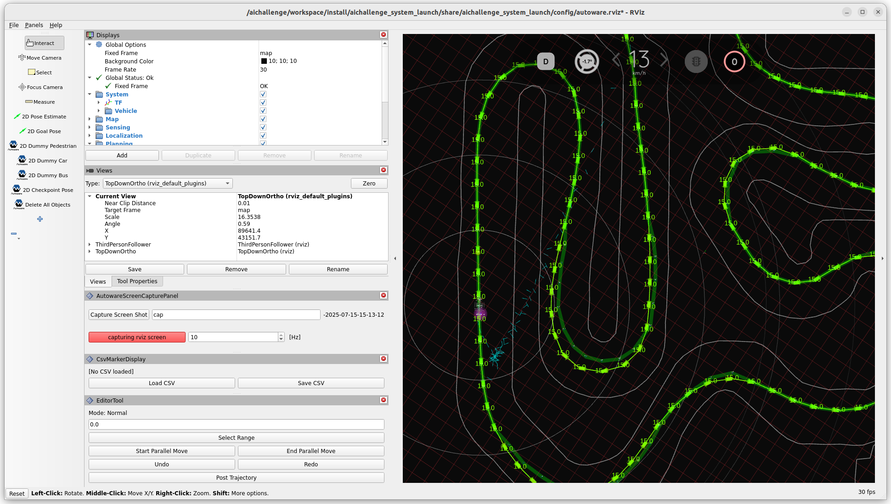
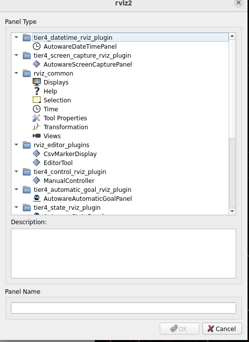
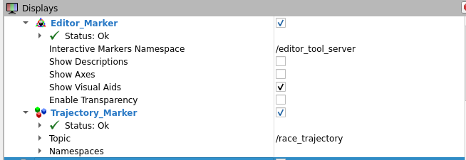
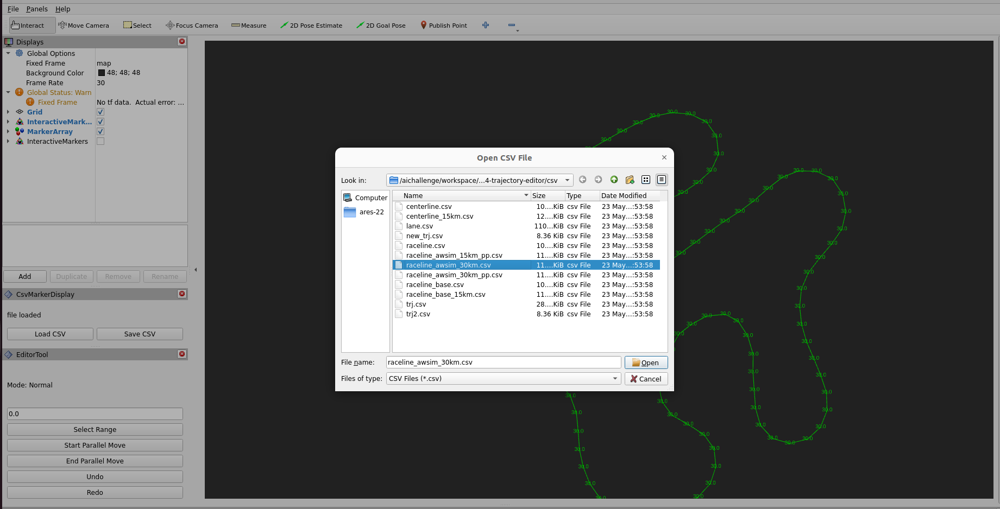

# AIChallenge Trajectory Editor

RViz 2上でAI Challenge向けの走行軌跡CSVを読み込み、速度や位置を編集してAutowareに反映するためのROS 2ツールです。



## 概要

このリポジトリは、CSVで定義された閉ループの走行軌跡をRViz 2上に表示し、GUI操作で編集するための3つのROS 2パッケージで構成されています。

| パッケージ | 役割 |
| --- | --- |
| `editor_tool_srvs` | CSV読み込み、CSV保存、範囲速度変更に使うサービス定義 |
| `editor_tool_server` | CSVとRVizマーカーの変換、編集状態の管理、編集用MarkerArrayのpublish |
| `rviz_editor_plugins` | RViz 2に追加する操作パネル |

主な機能は次の通りです。

- CSV軌跡の読み込みと保存
- 軌跡点のドラッグ移動
- 2点間の速度一括変更
- 2点間の軌跡点の平行移動
- Undo / Redo
- 編集済み軌跡のAutoware連携

## ディレクトリ構成

```text
.
├── autoware.rviz                 # このツール向けのRViz設定
├── csv/                          # サンプル軌跡CSV
├── editor_tool_server/           # 編集サーバノード
├── editor_tool_srvs/             # サービス定義
├── rviz_editor_plugins/          # RVizパネルプラグイン
└── asset/                        # README用画像
```

## CSV形式

CSVはヘッダ付きで、各行が1つの軌跡点を表します。

```csv
x,y,z,qx,qy,qz,qw,speed
```

| 列 | 内容 |
| --- | --- |
| `x,y,z` | `map`フレーム上の位置 |
| `qx,qy,qz,qw` | 姿勢のクォータニオン |
| `speed` | 速度。CSV上はm/s、RViz上の表示・入力はkm/h |

## ビルド

Autoware / ROS 2ワークスペースの`src`配下に配置して、依存パッケージと一緒にビルドします。

```bash
cd ~/aichallenge/workspace
colcon build --symlink-install --packages-up-to editor_tool_server rviz_editor_plugins
source install/setup.bash
```

## 起動

`editor_tool_server`を起動し、RViz 2で`autoware.rviz`を開きます。

```bash
# terminal 1
source ~/aichallenge/workspace/install/setup.bash
ros2 run editor_tool_server interactive_server \
  --ros-args --params-file src/aichallenge_submit/aichallenge-trajectory-editor/editor_tool_server/config/editor_tool_server.yaml

# terminal 2
source ~/aichallenge/workspace/install/setup.bash
rviz2 -d src/aichallenge_submit/aichallenge-trajectory-editor/autoware.rviz
```

既存のAutoware launchに組み込む場合は、次のようにノードを追加します。

```xml
<node pkg="editor_tool_server" exec="interactive_server" output="screen" name="editor_tool_server">
  <param name="csv_file_path" value="/aichallenge/workspace/src/aichallenge_submit/aichallenge-trajectory-editor/csv/raceline_base.csv"/>
  <param name="publish_on_initialize" value="true"/>
  <param name="wait_seconds" value="5.0"/>
  <param name="grad_min_speed" value="0.0"/>
  <param name="grad_mid_speed" value="30.0"/>
  <param name="grad_max_speed" value="60.0"/>
</node>
```

## パラメータ

| パラメータ | 既定値 | 内容 |
| --- | --- | --- |
| `csv_file_path` | `default.csv` | 起動時に読み込むCSV |
| `publish_on_initialize` | `true` | 起動時にCSVを読み込み、軌跡をpublishする |
| `wait_seconds` | `5.0` | 起動直後にCSVを読み込む前の待機秒数 |
| `grad_min_speed` | `0.0` | 速度色分けの下限 km/h |
| `grad_mid_speed` | `30.0` | 速度色分けの中間 km/h |
| `grad_max_speed` | `60.0` | 速度色分けの上限 km/h |

速度の色は低速が緑、中速が黄、高速が赤に近づくグラデーションです。

## RVizでの使い方

`autoware.rviz`を使わずに手動設定する場合は、RViz 2の`Panels -> Add New Panel`から次の2つを追加します。

- `rviz_editor_plugins/CsvMarkerDisplay`
- `rviz_editor_plugins/EditorTool`



必要に応じて`Displays`に次のトピックを追加します。

- `/race_trajectory`
- `/editor_tool_server`



操作手順は次の通りです。

1. `CsvMarkerDisplay`の`Load CSV`で編集対象CSVを読み込む。
2. RViz上の軌跡点をドラッグして位置を調整する。
3. `EditorTool`の速度入力欄にkm/hを入力し、`Select Range`後に軌跡上の2点をクリックして区間速度を変更する。
4. `Start Parallel Move`後に軌跡上の2点をクリックし、表示された青い球体マーカーをドラッグして区間を平行移動する。
5. `End Parallel Move`で平行移動を確定する。
6. 必要に応じて`Undo` / `Redo`で編集履歴を戻す。
7. `Save CSV`でCSVへ保存し、`Post Trajectory`でAutowareへ反映する。



## ROSインターフェース

### Publish

| トピック | 型 | 内容 |
| --- | --- | --- |
| `/race_trajectory` | `visualization_msgs/msg/MarkerArray` | RViz表示用の矢印、線、速度ラベル |

### Services

| サービス | 型 | 内容 |
| --- | --- | --- |
| `/load_csv` | `editor_tool_srvs/srv/LoadCsv` | CSVを読み込み、マーカーを再生成する |
| `/save_csv` | `editor_tool_srvs/srv/SaveCsv` | 現在の編集状態をCSVへ保存する |
| `/select_range` | `editor_tool_srvs/srv/SelectRange` | 速度変更用の2点選択モードを開始する |
| `/start_parallel_move` | `std_srvs/srv/Trigger` | 平行移動用の2点選択モードを開始する |
| `/confirm_parallel_move` | `std_srvs/srv/Trigger` | 平行移動を確定する |
| `/undo` | `std_srvs/srv/Trigger` | 直前の編集状態へ戻す |
| `/redo` | `std_srvs/srv/Trigger` | Undoした編集状態を再適用する |

`Post Trajectory`は、現在の編集状態を`/aichallenge/workspace/post/post_<timestamp>.csv`に保存し、`/planning/scenario_planning/simple_trajectory_generator`ノードの`csv_path`パラメータを更新します。Autowareへ渡す`/planning/scenario_planning/trajectory`は`simple_trajectory_generator`がpublishします。
